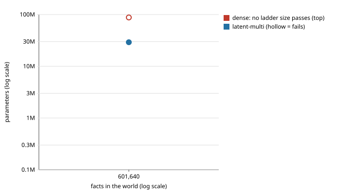

# Step 1 comparison report

*Generated by `python -m hemispheres.report` from the records in `results/step1/runs/`. Do not edit by hand.*

Exact-match accuracy in %: the whole generated answer must match. Each cell's question count, 95% interval and source file are in [every cell](#every-cell). † = from the summary logged during training (`metrics.jsonl`), which has no per-question records. — = not run. Setup, interpretation and caveats: [`research/results-step1.md`](../../research/results-step1.md).

## Main comparison

|  | lookup | dense | dense + FT on 100 edits | dense + trained on world B | context-a (QA only, world A) | context-multi (10k) | **context-multi (20k)** | context-multi (20k, seed 1) | latent-a | latent-a-all | **latent-multi** |
|---|---|---|---|---|---|---|---|---|---|---|---|
| World A, 1 hop, held-out people | 100 | 100 | — | — | 21.5 | 92 | 99 | 97.5 | 100 | 100 | 100 |
| World A, 2 hop, held-out people | 100 | 5.5 | — | — | 46 | 75 | 96 | 93.5 | 100 | 100 | 100 |
| World A, 3 hop, held-out people | 100 | 7.5 | — | — | 63.5 | 78.5 | 97 | 94 | 99 | 100 | 100 |
| World A, 2 / 3 hop, people seen in multi-hop training | 100 | 12.2 | — | — | 52 | 78.2 | 97.8 | 92.8 | 99.5 | 100 | 100 |
| 100 edits: the edited fact | 100 | 0 | 100 | — | 8 | 90 | 99 | 98 | 98 | 100 | 100 |
| 100 edits: ripple (multi-hop through an edit) | 100 | 2.2 | 14.6 | — | 34.2 | 77.4 | 98 | 92.2 | 99.4 | 100 | 100 |
| 100 edits: locality (untouched questions) | 100 | 33.2 | 9.2 | — | 48.4 | 80.2 | 97.6 | 95 | 99.8 | 100 | 100 |
| 100 edits: locality, 1 hop only | 100 | 100 | 24.7 | — | 15.7 | 95.5 | 98.9 | 98.9 | 100 | 100 | 100 |
| 1,000 edits: the edited fact | 100 | 0 | — | — | 11 | 86.8 | 97.2 | 95.6 | 99 | 100 | 100 |
| 1,000 edits: ripple | 100 | 2 | — | — | 24.8 | 72 | 96.4 | 94.2 | 99.8 | 100 | 100 |
| 1,000 edits: locality | 100 | 37.6 | — | — | 49.4 | 75.2 | 97.8 | 95.2 | 100 | 100 | 100 |
| Unseen world B, all hops | 99.6 | 1.1 | — | 0 | 11.8 | 79 | 97.3 | 94.9 | 41.8 | 86.2 | 100 |
| Unseen world C, all hops | 99.7 | — | — | — | — | 80.6 | 97.8 | 95 | 39.4 | 87.6 | 100 |
| World A, store values hidden (lower is better) | 0 | — | — | — | — | — | — | — | 3.9 | 2.8 | 1.6 |
| World A, world C's store (lower is better) | 0 | — | — | — | — | — | — | — | 1.3 | 1.2 | 1.1 |

- `dense + FT on 100 edits` is `dense-a` fine-tuned for 200 steps on the 100 edited facts; `dense + trained on world B` is `dense-a` trained for 2,000 more steps on world B's bios.
- The latent variants change one thing at a time: `latent-a-all` supervises retrieval at every name token, `latent-multi` also trains across 16 worlds.
- `context-a` is the in-context oracle arm trained on world-A questions only (no bios): it never learns to copy from its prompt. The `context-multi` runs use the other arms' mix (bios + QA) across the same 16 worlds as `latent-multi`; the `20k` runs train for twice the others' step budget, which the arm needs because its copy circuit forms late.

## World-swap errors by answer type

| world-b accuracy by answer type | lookup-a | latent-a | latent-a-all | latent-multi |
|---|---|---|---|---|
| people | 100 (n=89) | 0 (n=89) | 98.9 (n=89) | 100 (n=89) |
| companies | 100 (n=88) | 36.4 (n=88) | 100 (n=88) | 100 (n=88) |
| universities | 100 (n=109) | 3.7 (n=109) | 77.1 (n=109) | 100 (n=109) |
| cities | 100 (n=207) | 10.6 (n=207) | 69.1 (n=207) | 100 (n=207) |
| countries | 100 (n=89) | 4.5 (n=89) | 66.3 (n=89) | 100 (n=89) |
| currencies | 77.8 (n=18) | 77.8 (n=18) | 77.8 (n=18) | 100 (n=18) |
| single-token values (years, majors, industries) | 100 (n=300) | 100 (n=300) | 100 (n=300) | 100 (n=300) |

## Leakage: accuracy without the right store

Pooled over world-A `test_id` and `test_1hop_ood` (lower is better for the last two columns); in brackets, the range over hop counts.

| world-A test_id + test_1hop_ood | own store | values hidden | world C's store |
|---|---|---|---|
| lookup-a | 100 (100–100 by hop) | 0 (0–0 by hop) | 0 (0–0 by hop) |
| latent-a | 99.7 (99–100 by hop) | 3.9 (2.3–7 by hop) | 1.3 (0.3–2 by hop) |
| latent-a-all | 100 (100–100 by hop) | 2.8 (1–4.7 by hop) | 1.2 (1–1.7 by hop) |
| latent-multi | 100 (100–100 by hop) | 1.6 (1–2 by hop) | 1.1 (0.7–1.7 by hop) |

## Capacity: parameters needed versus facts known

Smallest model that holds each world's facts. Dense models store the facts in their weights: a dense size passes a world when every seed scores at least 95% one-hop accuracy on held-out people (at least 1,000 questions) and has its last two training evaluations within 1 point. Latent cores read the facts from the world's store and are evaluated on the larger worlds with no further training: a latent core passes when every seed scores at least 95% with its store keys compressed to 4 bits (TurboQuant; full-precision keys in brackets). Seeds are separated by /. Sources: [every cell](#every-cell).

| world | people | facts | smallest passing dense size | largest failing size below it | smallest passing latent core (4-bit keys) | largest failing core below it | latent cores: one-hop % with 4-bit keys (full precision) |
|---|---|---|---|---|---|---|---|
| world-b | 10,000 | 62,615 | 4m (3.74M) | 2m | latent-multi-500k (0.67M) | latent-multi-250k | latent-multi-250k (0.32M) 88.3 / 89.7 (98.9 / 99.3) fail; latent-multi-500k (0.67M) 95.6 / 95.9 (99.9 / 99.9) pass; latent-multi-1m (1.34M) 98.6 (99.9) pass; latent-multi-4m (4.52M) 99.9 (100) pass; latent-multi (29.16M) 99.7 (100) pass |
| world-b-30k | 30,000 | 182,381 | 4m (3.74M) | 2m | latent-multi-1m (1.34M) | latent-multi-500k | latent-multi-250k (0.32M) 80.5 / — (98.7 / —) fail; latent-multi-500k (0.67M) 93.6 / 93.7 (99.8 / 100) fail; latent-multi-1m (1.34M) 97.6 (100) pass; latent-multi-4m (4.52M) 99.3 (100) pass; latent-multi (29.16M) 99.3 (100) pass |
| world-b-100k | 100,000 | 601,640 | 16m (16.15M) | 8m | latent-multi-1m (1.34M) | latent-multi-500k | latent-multi-250k (0.32M) 68.6 / — (96.9 / —) fail; latent-multi-500k (0.67M) 87.4 / 87.3 (99.6 / 100) fail; latent-multi-1m (1.34M) 96.3 (99.9) pass; latent-multi-4m (4.52M) 98.4 (99.9) pass; latent-multi (29.16M) 98.5 (100) pass |

Dense ladder, one-hop held-out accuracy in % (seeds separated by /; * = not converged, ? = convergence unknown, n = shown when under 1,000 questions):

| dense size | params | world-b (10,000 people) | world-b-30k (30,000 people) | world-b-100k (100,000 people) |
|---|---|---|---|---|
| 250k | 0.23M | 6 fail | 6.4 fail | — |
| 500k | 0.50M | 6 fail | 6.6 fail | — |
| 1m | 1.06M | 48.7* / 58.7* fail | 18.6* fail | — |
| 2m | 1.94M | 97.6 / 95.2* fail | 37 / 45.5 fail | — |
| 4m | 3.74M | 100 / 99.9 pass | 97.2 / 98 pass | — |
| 8m | 7.56M | 99.9 pass | 100 pass | 74.7* / 73.8* fail |
| 16m | 16.15M | 100 pass | 100 pass | 97.8 / 98.2 pass |

## Cost per answered question

Per question asked, right or wrong, calculated from each model's shape and the store size: the mean over the one-hop held-out questions of each run's final evaluation on that world (or all its questions when it has none), as if generating one question at a time with a key-value cache. Compute counts 2 operations per parameter per token and attention; store compute counts scoring every store key at every read layer and attending over the retrieved names. Memory read counts every parameter and every store key once per forward pass. Left out: key-value cache reads, encoding the store's keys (once per store write) and the lookup arm's external store. Tokens per question include the prompt, the generated answer with [EOS], and any store-inserted tokens. Rows with stored keys at N bits score queries against keys compressed with TurboQuant: N bits per number plus two 32-bit norms per key (evaluate --key-bits). Only evaluations that record token counts appear.

| run | world | questions | n | params | tokens per question | model MFLOP | store MFLOP | weights MB read | store MB read | source |
|---|---|---|---|---|---|---|---|---|---|---|
| context-a | world-a | one-hop held-out | 200 | 25.47M | 107.6 | 5,527.3 | 0.0 | 372.4 | 0.0 | `evals/world-a-final.jsonl` |
| context-a | world-b | all evaluated | 900 | 25.47M | 125.3 | 6,461.6 | 0.0 | 358.3 | 0.0 | `evals/world-b-final.jsonl` |
| context-multi-bios | world-c | all evaluated | 900 | 25.47M | 124.7 | 6,428.1 | 0.0 | 361.6 | 0.0 | `evals/world-c-final.jsonl` |
| context-multi-bios | world-a | one-hop held-out | 200 | 25.47M | 107.6 | 5,523.9 | 0.0 | 365.7 | 0.0 | `evals/world-a-final.jsonl` |
| context-multi-bios | world-b | all evaluated | 900 | 25.47M | 125.4 | 6,467.9 | 0.0 | 370.4 | 0.0 | `evals/world-b-final.jsonl` |
| context-multi-bios-20k | world-c | all evaluated | 900 | 25.47M | 124.7 | 6,428.6 | 0.0 | 362.6 | 0.0 | `evals/world-c-final.jsonl` |
| context-multi-bios-20k | world-a | one-hop held-out | 200 | 25.47M | 107.6 | 5,524.1 | 0.0 | 366.3 | 0.0 | `evals/world-a-final.jsonl` |
| context-multi-bios-20k | world-b | all evaluated | 900 | 25.47M | 125.4 | 6,468.8 | 0.0 | 372.0 | 0.0 | `evals/world-b-final.jsonl` |
| context-multi-bios-20k-s1 | world-c | all evaluated | 900 | 25.47M | 124.7 | 6,428.9 | 0.0 | 363.1 | 0.0 | `evals/world-c-final.jsonl` |
| context-multi-bios-20k-s1 | world-a | one-hop held-out | 200 | 25.47M | 107.6 | 5,523.3 | 0.0 | 364.7 | 0.0 | `evals/world-a-final.jsonl` |
| context-multi-bios-20k-s1 | world-b | all evaluated | 900 | 25.47M | 125.4 | 6,468.8 | 0.0 | 372.1 | 0.0 | `evals/world-b-final.jsonl` |
| dense-16m-b100k | world-b-100k | one-hop held-out | 1000 | 16.15M | 18.4 | 563.0 | 0.0 | 245.7 | 0.0 | `evals/world-b-100k-heldout-final.jsonl` |
| dense-16m-b100k-s1 | world-b-100k | one-hop held-out | 1000 | 16.15M | 18.3 | 562.7 | 0.0 | 245.2 | 0.0 | `evals/world-b-100k-heldout-final.jsonl` |
| dense-16m-b10k | world-b | one-hop held-out | 1000 | 16.15M | 18.3 | 561.0 | 0.0 | 242.3 | 0.0 | `evals/world-b-heldout-final.jsonl` |
| dense-16m-b30k | world-b-30k | one-hop held-out | 1000 | 16.15M | 18.2 | 558.0 | 0.0 | 238.4 | 0.0 | `evals/world-b-30k-heldout-final.jsonl` |
| dense-1m-b10k | world-b | one-hop held-out | 1000 | 1.06M | 18.5 | 37.5 | 0.0 | 16.9 | 0.0 | `evals/world-b-heldout-final.jsonl` |
| dense-1m-b10k-s1 | world-b | one-hop held-out | 1000 | 1.06M | 18.3 | 37.0 | 0.0 | 15.8 | 0.0 | `evals/world-b-heldout-final.jsonl` |
| dense-1m-b30k | world-b-30k | one-hop held-out | 1000 | 1.06M | 18.4 | 37.2 | 0.0 | 16.4 | 0.0 | `evals/world-b-30k-heldout-final.jsonl` |
| dense-250k-b10k | world-b | one-hop held-out | 1000 | 0.23M | 18.3 | 8.3 | 0.0 | 3.5 | 0.0 | `evals/world-b-heldout-final.jsonl` |
| dense-250k-b30k | world-b-30k | one-hop held-out | 1000 | 0.23M | 18.1 | 8.2 | 0.0 | 3.4 | 0.0 | `evals/world-b-30k-heldout-final.jsonl` |
| dense-2m-b10k | world-b | one-hop held-out | 1000 | 1.94M | 18.3 | 67.7 | 0.0 | 29.1 | 0.0 | `evals/world-b-heldout-final.jsonl` |
| dense-2m-b10k-s1 | world-b | one-hop held-out | 1000 | 1.94M | 18.3 | 67.7 | 0.0 | 29.3 | 0.0 | `evals/world-b-heldout-final.jsonl` |
| dense-2m-b30k | world-b-30k | one-hop held-out | 1000 | 1.94M | 18.3 | 67.5 | 0.0 | 29.1 | 0.0 | `evals/world-b-30k-heldout-final.jsonl` |
| dense-2m-b30k-s1 | world-b-30k | one-hop held-out | 1000 | 1.94M | 18.2 | 67.4 | 0.0 | 28.9 | 0.0 | `evals/world-b-30k-heldout-final.jsonl` |
| dense-4m-b10k | world-b | one-hop held-out | 1000 | 3.74M | 18.3 | 130.4 | 0.0 | 56.2 | 0.0 | `evals/world-b-heldout-final.jsonl` |
| dense-4m-b10k-s1 | world-b | one-hop held-out | 1000 | 3.74M | 18.3 | 130.4 | 0.0 | 56.2 | 0.0 | `evals/world-b-heldout-final.jsonl` |
| dense-4m-b30k | world-b-30k | one-hop held-out | 1000 | 3.74M | 18.2 | 129.9 | 0.0 | 55.6 | 0.0 | `evals/world-b-30k-heldout-final.jsonl` |
| dense-4m-b30k-s1 | world-b-30k | one-hop held-out | 1000 | 3.74M | 18.2 | 130.0 | 0.0 | 55.8 | 0.0 | `evals/world-b-30k-heldout-final.jsonl` |
| dense-500k-b10k | world-b | one-hop held-out | 1000 | 0.50M | 18.5 | 17.7 | 0.0 | 7.8 | 0.0 | `evals/world-b-heldout-final.jsonl` |
| dense-500k-b30k | world-b-30k | one-hop held-out | 1000 | 0.50M | 18.4 | 17.6 | 0.0 | 7.7 | 0.0 | `evals/world-b-30k-heldout-final.jsonl` |
| dense-8m-b100k | world-b-100k | one-hop held-out | 1000 | 7.56M | 18.3 | 263.4 | 0.0 | 114.3 | 0.0 | `evals/world-b-100k-heldout-final.jsonl` |
| dense-8m-b100k-s1 | world-b-100k | one-hop held-out | 1000 | 7.56M | 18.4 | 264.5 | 0.0 | 116.6 | 0.0 | `evals/world-b-100k-heldout-final.jsonl` |
| dense-8m-b10k | world-b | one-hop held-out | 1000 | 7.56M | 18.3 | 262.8 | 0.0 | 113.4 | 0.0 | `evals/world-b-heldout-final.jsonl` |
| dense-8m-b30k | world-b-30k | one-hop held-out | 1000 | 7.56M | 18.2 | 261.4 | 0.0 | 111.6 | 0.0 | `evals/world-b-30k-heldout-final.jsonl` |
| dense-a | world-a | one-hop held-out | 200 | 25.47M | 18.2 | 877.0 | 0.0 | 365.7 | 0.0 | `evals/world-a-final.jsonl` |
| dense-a | world-b | all evaluated | 900 | 25.47M | 21.8 | 1,064.0 | 0.0 | 372.8 | 0.0 | `evals/world-b-final.jsonl` |
| dense-a-k100 | world-a | all, 100 edits | 1100 | 25.47M | 23.2 | 1,134.6 | 0.0 | 384.8 | 0.0 | `evals/world-a-k100-final.jsonl` |
| dense-a-to-b | world-b | all evaluated | 900 | 25.47M | 40.7 | 2,036.3 | 0.0 | 2,298.0 | 0.0 | `evals/world-b-final.jsonl` |
| latent-a | world-c | all evaluated | 900 | 29.16M | 21.3 | 1,189.6 | 982.0 | 366.0 | 301.7 | `evals/world-c-final.jsonl` |
| latent-a | world-a | one-hop held-out | 200 | 29.16M | 18.2 | 1,003.6 | 828.8 | 418.7 | 345.2 | `evals/world-a-final.jsonl` |
| latent-a | world-b | all evaluated | 900 | 29.16M | 21.5 | 1,197.4 | 988.5 | 386.7 | 318.9 | `evals/world-b-final.jsonl` |
| latent-a-all | world-c | all evaluated | 900 | 29.16M | 21.7 | 1,211.1 | 999.6 | 408.6 | 336.9 | `evals/world-c-final.jsonl` |
| latent-a-all | world-a | one-hop held-out | 200 | 29.16M | 18.2 | 1,003.6 | 828.8 | 418.7 | 345.2 | `evals/world-a-final.jsonl` |
| latent-a-all | world-b | all evaluated | 900 | 29.16M | 21.7 | 1,212.0 | 1,000.5 | 415.9 | 342.9 | `evals/world-b-final.jsonl` |
| latent-multi | world-c | all evaluated | 900 | 29.16M | 21.8 | 1,214.6 | 1,002.6 | 415.7 | 342.8 | `evals/world-c-final.jsonl` |
| latent-multi | world-a | one-hop held-out | 200 | 29.16M | 18.2 | 1,003.6 | 828.8 | 418.7 | 345.2 | `evals/world-a-final.jsonl` |
| latent-multi | world-b | one-hop held-out | 1000 | 29.16M | 18.3 | 1,011.3 | 835.3 | 437.4 | 360.7 | `evals/world-b-heldout-final.jsonl` |
| latent-multi | world-b | one-hop held-out, stored keys at 4 bits | 1000 | 29.16M | 18.3 | 1,011.3 | 835.3 | 437.4 | 50.7 | `evals/world-b-keys4-final.jsonl` |
| latent-multi | world-b-30k | one-hop held-out | 1000 | 29.16M | 18.2 | 1,005.9 | 2,413.4 | 430.4 | 1,033.7 | `evals/world-b-30k-heldout-final.jsonl` |
| latent-multi | world-b-30k | one-hop held-out, stored keys at 4 bits | 1000 | 29.16M | 18.2 | 1,006.0 | 2,413.5 | 430.5 | 145.4 | `evals/world-b-30k-keys4-final.jsonl` |
| latent-multi | world-b-100k | one-hop held-out | 1000 | 29.16M | 18.4 | 1,014.8 | 8,023.5 | 443.6 | 3,514.4 | `evals/world-b-100k-heldout-final.jsonl` |
| latent-multi | world-b-100k | one-hop held-out, stored keys | 1000 | 29.16M | 18.4 | 1,014.8 | 8,023.5 | 443.6 | 3,514.4 | `evals/world-b-100k-keys32-final.jsonl` |
| latent-multi | world-b-100k | one-hop held-out, stored keys at 8 bits | 1000 | 29.16M | 18.4 | 1,014.8 | 8,023.5 | 443.6 | 933.5 | `evals/world-b-100k-keys8-final.jsonl` |
| latent-multi | world-b-100k | one-hop held-out, stored keys at 4 bits | 1000 | 29.16M | 18.4 | 1,015.0 | 8,024.9 | 443.9 | 494.6 | `evals/world-b-100k-keys4-final.jsonl` |
| latent-multi | world-b-100k | one-hop held-out, stored keys at 3 bits | 1000 | 29.16M | 18.4 | 1,015.6 | 8,029.5 | 445.1 | 385.7 | `evals/world-b-100k-keys3-final.jsonl` |
| latent-multi-1m | world-b | one-hop held-out | 1000 | 1.34M | 18.3 | 46.8 | 832.7 | 20.1 | 360.7 | `evals/world-b-heldout-final.jsonl` |
| latent-multi-1m | world-b | one-hop held-out, stored keys at 4 bits | 1000 | 1.34M | 18.3 | 46.8 | 832.9 | 20.2 | 50.8 | `evals/world-b-keys4-final.jsonl` |
| latent-multi-1m | world-b-30k | one-hop held-out | 1000 | 1.34M | 18.2 | 46.6 | 2,410.8 | 19.8 | 1,033.7 | `evals/world-b-30k-heldout-final.jsonl` |
| latent-multi-1m | world-b-30k | one-hop held-out, stored keys at 4 bits | 1000 | 1.34M | 18.2 | 46.6 | 2,411.6 | 19.8 | 145.6 | `evals/world-b-30k-keys4-final.jsonl` |
| latent-multi-1m | world-b-100k | one-hop held-out | 1000 | 1.34M | 18.4 | 47.0 | 8,020.8 | 20.4 | 3,514.4 | `evals/world-b-100k-heldout-final.jsonl` |
| latent-multi-1m | world-b-100k | one-hop held-out, stored keys at 4 bits | 1000 | 1.34M | 18.4 | 47.0 | 8,024.1 | 20.4 | 495.1 | `evals/world-b-100k-keys4-final.jsonl` |
| latent-multi-250k | world-b | one-hop held-out | 1000 | 0.32M | 18.3 | 11.3 | 832.1 | 4.8 | 360.4 | `evals/world-b-heldout-final.jsonl` |
| latent-multi-250k | world-b | one-hop held-out, stored keys at 4 bits | 1000 | 0.32M | 18.3 | 11.3 | 832.6 | 4.8 | 50.8 | `evals/world-b-keys4-final.jsonl` |
| latent-multi-250k | world-b-30k | one-hop held-out | 1000 | 0.32M | 18.2 | 11.3 | 2,410.0 | 4.8 | 1,033.1 | `evals/world-b-30k-heldout-final.jsonl` |
| latent-multi-250k | world-b-30k | one-hop held-out, stored keys at 4 bits | 1000 | 0.32M | 18.2 | 11.3 | 2,409.8 | 4.8 | 145.2 | `evals/world-b-30k-keys4-final.jsonl` |
| latent-multi-250k | world-b-100k | one-hop held-out | 1000 | 0.32M | 18.4 | 11.4 | 8,019.0 | 4.9 | 3,511.7 | `evals/world-b-100k-heldout-final.jsonl` |
| latent-multi-250k | world-b-100k | one-hop held-out, stored keys at 4 bits | 1000 | 0.32M | 18.3 | 11.3 | 8,005.6 | 4.9 | 490.1 | `evals/world-b-100k-keys4-final.jsonl` |
| latent-multi-250k-s1 | world-a | one-hop held-out | 200 | 0.32M | 18.3 | 11.3 | 834.0 | 5.0 | 370.2 | `evals/world-a-step10000.jsonl` |
| latent-multi-250k-s1 | world-b | one-hop held-out | 1000 | 0.32M | 18.3 | 11.3 | 832.2 | 4.8 | 360.6 | `evals/world-b-heldout-final.jsonl` |
| latent-multi-250k-s1 | world-b | one-hop held-out, stored keys at 4 bits | 1000 | 0.32M | 18.3 | 11.3 | 832.5 | 4.8 | 50.8 | `evals/world-b-keys4-final.jsonl` |
| latent-multi-4m | world-b | one-hop held-out | 1000 | 4.52M | 18.3 | 157.2 | 833.3 | 67.8 | 360.7 | `evals/world-b-heldout-final.jsonl` |
| latent-multi-4m | world-b | one-hop held-out, stored keys at 4 bits | 1000 | 4.52M | 18.3 | 157.2 | 833.4 | 67.8 | 50.7 | `evals/world-b-keys4-final.jsonl` |
| latent-multi-4m | world-b-30k | one-hop held-out | 1000 | 4.52M | 18.2 | 156.4 | 2,411.4 | 66.7 | 1,033.7 | `evals/world-b-30k-heldout-final.jsonl` |
| latent-multi-4m | world-b-30k | one-hop held-out, stored keys at 4 bits | 1000 | 4.52M | 18.2 | 156.4 | 2,411.5 | 66.7 | 145.4 | `evals/world-b-30k-keys4-final.jsonl` |
| latent-multi-4m | world-b-100k | one-hop held-out | 1000 | 4.52M | 18.4 | 157.8 | 8,021.5 | 68.8 | 3,514.4 | `evals/world-b-100k-heldout-final.jsonl` |
| latent-multi-4m | world-b-100k | one-hop held-out, stored keys at 4 bits | 1000 | 4.52M | 18.4 | 157.8 | 8,021.5 | 68.8 | 494.2 | `evals/world-b-100k-keys4-final.jsonl` |
| latent-multi-500k | world-a | one-hop held-out | 200 | 0.67M | 18.2 | 23.3 | 826.0 | 9.6 | 345.2 | `evals/world-a-step10000.jsonl` |
| latent-multi-500k | world-b | one-hop held-out | 1000 | 0.67M | 18.3 | 23.5 | 832.4 | 10.1 | 360.6 | `evals/world-b-heldout-final.jsonl` |
| latent-multi-500k | world-b | one-hop held-out, stored keys at 4 bits | 1000 | 0.67M | 18.3 | 23.5 | 832.6 | 10.1 | 50.8 | `evals/world-b-keys4-final.jsonl` |
| latent-multi-500k | world-b-30k | one-hop held-out | 1000 | 0.67M | 18.2 | 23.3 | 2,410.5 | 9.9 | 1,033.7 | `evals/world-b-30k-heldout-final.jsonl` |
| latent-multi-500k | world-b-30k | one-hop held-out, stored keys at 4 bits | 1000 | 0.67M | 18.2 | 23.3 | 2,411.5 | 9.9 | 145.6 | `evals/world-b-30k-keys4-final.jsonl` |
| latent-multi-500k | world-b-100k | one-hop held-out | 1000 | 0.67M | 18.4 | 23.5 | 8,020.6 | 10.2 | 3,514.4 | `evals/world-b-100k-heldout-final.jsonl` |
| latent-multi-500k | world-b-100k | one-hop held-out, stored keys at 4 bits | 1000 | 0.67M | 18.4 | 23.5 | 8,020.6 | 10.2 | 494.2 | `evals/world-b-100k-keys4-final.jsonl` |
| latent-multi-500k-s1 | world-a | one-hop held-out | 200 | 0.67M | 18.2 | 23.4 | 829.6 | 10.1 | 361.1 | `evals/world-a-step10000.jsonl` |
| latent-multi-500k-s1 | world-b | one-hop held-out | 1000 | 0.67M | 18.3 | 23.5 | 832.4 | 10.1 | 360.7 | `evals/world-b-heldout-final.jsonl` |
| latent-multi-500k-s1 | world-b | one-hop held-out, stored keys at 4 bits | 1000 | 0.67M | 18.3 | 23.5 | 833.0 | 10.1 | 50.9 | `evals/world-b-keys4-final.jsonl` |
| latent-multi-500k-s1 | world-b-30k | one-hop held-out | 1000 | 0.67M | 18.2 | 23.3 | 2,410.5 | 9.9 | 1,033.7 | `evals/world-b-30k-heldout-final.jsonl` |
| latent-multi-500k-s1 | world-b-30k | one-hop held-out, stored keys at 4 bits | 1000 | 0.67M | 18.2 | 23.4 | 2,414.6 | 10.0 | 146.5 | `evals/world-b-30k-keys4-final.jsonl` |
| latent-multi-500k-s1 | world-b-100k | one-hop held-out | 1000 | 0.67M | 18.4 | 23.5 | 8,020.6 | 10.2 | 3,514.4 | `evals/world-b-100k-heldout-final.jsonl` |
| latent-multi-500k-s1 | world-b-100k | one-hop held-out, stored keys at 4 bits | 1000 | 0.67M | 18.4 | 23.6 | 8,035.0 | 10.3 | 498.2 | `evals/world-b-100k-keys4-final.jsonl` |
| latent-multi-nohop | world-a | one-hop held-out | 200 | 29.16M | 18.3 | 1,014.1 | 837.5 | 439.7 | 362.6 | `evals/world-a-latest.jsonl` |
| lookup-a | world-c | all evaluated | 900 | 25.47M | 46.2 | 2,320.8 | 0.0 | 1,949.7 | 0.0 | `evals/world-c-final.jsonl` |
| lookup-a | world-a | one-hop held-out | 200 | 25.47M | 30.0 | 1,485.0 | 0.0 | 1,206.7 | 0.0 | `evals/world-a-final.jsonl` |
| lookup-a | world-b | all evaluated | 900 | 25.47M | 46.5 | 2,338.5 | 0.0 | 1,967.3 | 0.0 | `evals/world-b-final.jsonl` |

## Hop supervision

From `metrics.jsonl`: retrieval accuracy on training batches, logged every 100 steps. Chance is 1 in 62.6k.

|  | latent-multi (hop weight 0.5) | latent-multi-nohop (hop weight 0.0) |
|---|---|---|
| Retrieval top-1 % during training, hops 1 / 2 / 3, step 500 | 96.6 / 44.7 / 1.48 | 0.00346 / 0.01 / 0.0178 |
| Retrieval top-1 % during training, hops 1 / 2 / 3, step 3000 | 99.8 / 98.7 / 98.6 | 0.00116 / 0.00982 / 0.157 |
| Training loss, step 2000 | 0.541 | 1.16 |
| Training loss, step 3000 | 0.513 | 1.13 |
| Retrieval (InfoNCE) loss, step 100 | 10.4 | 11.1 |
| Retrieval (InfoNCE) loss, step 3000 | 0.0236 | 79.3 |
| World A held-out at step 2,000: 1 / 2 / 3 hop | 94.5† / 86† / 90.5† | 8† / 6† / 4† |

## Runs

Every flag, seed and model shape is in `runs/<run>/config.json`; checkpoint hashes and the fingerprint of every world read are in `runs/<run>/provenance.json`. "(inferred)" code versions were not recorded at training time: they are the last commit before the run started, and the working tree may have had uncommitted changes. `*` = uncommitted changes.

| run | arm | params | worlds | steps | seed | settings | code | final weights sha256 |
|---|---|---|---|---|---|---|---|---|
| context-a | context | 25.5M | world-a | 10,000 | 0 | mix qa=1 | 2858beb (inferred) | `ae48aaa6bc50` |
| context-multi-bios | context | 25.5M | world-a + 15 pool | 10,000 | 0 | mix bios=0.5,qa=0.5 | 4fc4e67 | `8d97615b89a9` |
| context-multi-bios-20k | context | 25.5M | world-a + 15 pool | 20,000 | 0 | mix bios=0.5,qa=0.5 | 4fc4e67 | `11424cc903c9` |
| context-multi-bios-20k-s1 | context | 25.5M | world-a + 15 pool | 20,000 | 1 | mix bios=0.5,qa=0.5 | 4fc4e67 | `4e9410c97d16` |
| dense-16m-b100k | dense | 16.2M | world-b-100k | 105,508 | 0 | mix bios=0.5,qa=0.5 | c1586c2 | `f5fd62037aaf` |
| dense-16m-b100k-s1 | dense | 16.2M | world-b-100k | 105,508 | 1 | mix bios=0.5,qa=0.5 | c1586c2 | `e196efba9856` |
| dense-16m-b10k | dense | 16.2M | world-b | 11,091 | 0 | mix bios=0.5,qa=0.5 | b09ad1b | `21e9fb0e5b76` |
| dense-16m-b30k | dense | 16.2M | world-b-30k | 32,067 | 0 | mix bios=0.5,qa=0.5 | b09ad1b | `3c8eae1507ef` |
| dense-1m-b10k | dense | 1.1M | world-b | 11,091 | 0 | mix bios=0.5,qa=0.5 | b09ad1b | `6fb6a59ed930` |
| dense-1m-b10k-s1 | dense | 1.1M | world-b | 11,091 | 1 | mix bios=0.5,qa=0.5 | b09ad1b | `c6d88ee5768f` |
| dense-1m-b30k | dense | 1.1M | world-b-30k | 32,067 | 0 | mix bios=0.5,qa=0.5 | b09ad1b | `6f8c5dd9ea76` |
| dense-250k-b10k | dense | 0.2M | world-b | 11,091 | 0 | mix bios=0.5,qa=0.5 | b09ad1b | `673b3e95bd00` |
| dense-250k-b30k | dense | 0.2M | world-b-30k | 32,067 | 0 | mix bios=0.5,qa=0.5 | b09ad1b | `0a5544b64438` |
| dense-2m-b10k | dense | 1.9M | world-b | 11,091 | 0 | mix bios=0.5,qa=0.5 | b09ad1b | `5467be843fbe` |
| dense-2m-b10k-s1 | dense | 1.9M | world-b | 11,091 | 1 | mix bios=0.5,qa=0.5 | b09ad1b | `27715654e151` |
| dense-2m-b30k | dense | 1.9M | world-b-30k | 32,067 | 0 | mix bios=0.5,qa=0.5 | b09ad1b | `76d558f2877b` |
| dense-2m-b30k-s1 | dense | 1.9M | world-b-30k | 32,067 | 1 | mix bios=0.5,qa=0.5 | b09ad1b | `df7c4f58a50a` |
| dense-4m-b10k | dense | 3.7M | world-b | 11,091 | 0 | mix bios=0.5,qa=0.5 | b09ad1b | `2ffcc8bfc11c` |
| dense-4m-b10k-s1 | dense | 3.7M | world-b | 11,091 | 1 | mix bios=0.5,qa=0.5 | be82eb7 | `d920fc98c6e9` |
| dense-4m-b30k | dense | 3.7M | world-b-30k | 32,067 | 0 | mix bios=0.5,qa=0.5 | b09ad1b | `2e69664606b4` |
| dense-4m-b30k-s1 | dense | 3.7M | world-b-30k | 32,067 | 1 | mix bios=0.5,qa=0.5 | 663b2a2 | `9dbb9b238f08` |
| dense-500k-b10k | dense | 0.5M | world-b | 11,091 | 0 | mix bios=0.5,qa=0.5 | b09ad1b | `d05c3f295557` |
| dense-500k-b30k | dense | 0.5M | world-b-30k | 32,067 | 0 | mix bios=0.5,qa=0.5 | b09ad1b | `f7103992a37e` |
| dense-8m-b100k | dense | 7.6M | world-b-100k | 105,508 | 0 | mix bios=0.5,qa=0.5 | c1586c2 | `888b1fd6b324` |
| dense-8m-b100k-s1 | dense | 7.6M | world-b-100k | 105,508 | 1 | mix bios=0.5,qa=0.5 | c1586c2 | `b038ed2a9b46` |
| dense-8m-b10k | dense | 7.6M | world-b | 11,091 | 0 | mix bios=0.5,qa=0.5 | b09ad1b | `637f80d5f36d` |
| dense-8m-b30k | dense | 7.6M | world-b-30k | 32,067 | 0 | mix bios=0.5,qa=0.5 | b09ad1b | `66c39598024f` |
| dense-a | dense | 25.5M | world-a | 10,000 | 0 | mix bios=0.5,qa=0.5 | 2858beb (inferred) | `81e8eb4ac912` |
| dense-a-k100 | dense | 25.5M | world-a | 200 | 0 | mix edit_facts=1,edit_qa=1; init dense-a; edits 100 | 2858beb (inferred) | `c2535e281e08` |
| dense-a-to-b | dense | 25.5M | world-b | 2,000 | 0 | mix bios=1; init dense-a | 2858beb (inferred) | `17c630e69033` |
| latent-a | latent | 29.2M | world-a | 10,000 | 0 | mix bios=0.5,qa=0.5; hop weight 0.5; supervise first | 2858beb (inferred) | `f4f3b1fbe96a` |
| latent-a-all | latent | 29.2M | world-a | 10,000 | 0 | mix bios=0.5,qa=0.5; hop weight 0.5; supervise all | d98359c (inferred) | `57dc7d12714c` |
| latent-multi | latent | 29.2M | world-a + 15 pool | 10,000 | 0 | mix bios=0.5,qa=0.5; hop weight 0.5; supervise all | d98359c (inferred) | `1b2490e51d93` |
| latent-multi-1m | latent | 1.3M | world-a + 15 pool | 10,000 | 0 | mix bios=0.5,qa=0.5; hop weight 0.5; supervise all | b09ad1b | `74e883b60ed3` |
| latent-multi-250k | latent | 0.3M | world-a + 15 pool | 10,000 | 0 | mix bios=0.5,qa=0.5; hop weight 0.5; supervise all | b09ad1b | `4b2faf794e0a` |
| latent-multi-250k-s1 | latent | 0.3M | world-a + 15 pool | 10,000 | 1 | mix bios=0.5,qa=0.5; hop weight 0.5; supervise all | c1586c2 | `973636992adb` |
| latent-multi-4m | latent | 4.5M | world-a + 15 pool | 10,000 | 0 | mix bios=0.5,qa=0.5; hop weight 0.5; supervise all | b09ad1b | `b0a5f2d97c3e` |
| latent-multi-500k | latent | 0.7M | world-a + 15 pool | 10,000 | 0 | mix bios=0.5,qa=0.5; hop weight 0.5; supervise all | c1586c2 | `ad9d6f640e2d` |
| latent-multi-500k-s1 | latent | 0.7M | world-a + 15 pool | 10,000 | 1 | mix bios=0.5,qa=0.5; hop weight 0.5; supervise all | c1586c2 | `768acb3051ac` |
| latent-multi-nohop | latent | 29.2M | world-a + 15 pool | 3,300 of 10,000 | 0 | mix bios=0.5,qa=0.5; hop weight 0; supervise all | 910fcdb (inferred) | `dc2494c38336` |
| lookup-a | lookup | 25.5M | world-a | 10,000 | 0 | mix bios=0.5,qa=0.5 | 07088fd (inferred) | `e06385a28712` |

## Integrity

- 358 evaluation files: every summary recounted from its per-question records matches.
- Evaluations logged during training, rerun from the saved checkpoint on the same questions (context-a, context-multi-bios, context-multi-bios-20k, dense-16m-b100k, dense-16m-b10k, dense-16m-b30k, dense-1m-b10k, dense-1m-b30k, dense-250k-b10k, dense-250k-b30k, dense-2m-b10k, dense-2m-b30k, dense-4m-b10k, dense-4m-b30k, dense-500k-b10k, dense-500k-b30k, dense-8m-b100k, dense-8m-b10k, dense-8m-b30k, dense-a, dense-a-k100, dense-a-to-b, latent-a, latent-a-all, latent-multi, latent-multi-nohop, lookup-a): 122 of 122 cells identical.
- 0 cells come from logged summaries only (†).
- Worlds: `worlds.json` holds each world's build config and file hashes. `python -m hemispheres.records verify-data data/<world>` checks a rebuilt world against them.

## Reproducing

`reproduce.sh` has every command, generated from the records: world builds, training runs (with every recorded flag) and evaluations. Retraining at a different code version or MLX build may not be bit-identical. Compare at the level of this report.

The weights are on the Hugging Face Hub at [SceneWorks/hemispheres-step1](https://huggingface.co/SceneWorks/hemispheres-step1), commit `9880aae`. `python -m hemispheres.records fetch <run>` downloads a run into `runs/<run>/` and checks every file against the sha256 above, so the evaluations can be rerun without retraining.

## Every cell

| row | run | correct / n | % | 95% CI | source |
|---|---|---|---|---|---|
| World A, 1 hop, held-out people | lookup-a | 200/200 | 100 | 98.1–100 | `evals/world-a-final.jsonl` |
| World A, 1 hop, held-out people | dense-a | 200/200 | 100 | 98.1–100 | `evals/world-a-final.jsonl` |
| World A, 1 hop, held-out people | context-a | 43/200 | 21.5 | 16.4–27.7 | `evals/world-a-final.jsonl` |
| World A, 1 hop, held-out people | context-multi-bios | 184/200 | 92 | 87.4–95 | `evals/world-a-final.jsonl` |
| World A, 1 hop, held-out people | context-multi-bios-20k | 198/200 | 99 | 96.4–99.7 | `evals/world-a-final.jsonl` |
| World A, 1 hop, held-out people | context-multi-bios-20k-s1 | 195/200 | 97.5 | 94.3–98.9 | `evals/world-a-final.jsonl` |
| World A, 1 hop, held-out people | latent-a | 200/200 | 100 | 98.1–100 | `evals/world-a-final.jsonl` |
| World A, 1 hop, held-out people | latent-a-all | 200/200 | 100 | 98.1–100 | `evals/world-a-final.jsonl` |
| World A, 1 hop, held-out people | latent-multi | 200/200 | 100 | 98.1–100 | `evals/world-a-final.jsonl` |
| World A, 2 hop, held-out people | lookup-a | 200/200 | 100 | 98.1–100 | `evals/world-a-final.jsonl` |
| World A, 2 hop, held-out people | dense-a | 11/200 | 5.5 | 3.1–9.6 | `evals/world-a-final.jsonl` |
| World A, 2 hop, held-out people | context-a | 92/200 | 46 | 39.2–52.9 | `evals/world-a-final.jsonl` |
| World A, 2 hop, held-out people | context-multi-bios | 150/200 | 75 | 68.6–80.5 | `evals/world-a-final.jsonl` |
| World A, 2 hop, held-out people | context-multi-bios-20k | 192/200 | 96 | 92.3–98 | `evals/world-a-final.jsonl` |
| World A, 2 hop, held-out people | context-multi-bios-20k-s1 | 187/200 | 93.5 | 89.2–96.2 | `evals/world-a-final.jsonl` |
| World A, 2 hop, held-out people | latent-a | 200/200 | 100 | 98.1–100 | `evals/world-a-final.jsonl` |
| World A, 2 hop, held-out people | latent-a-all | 200/200 | 100 | 98.1–100 | `evals/world-a-final.jsonl` |
| World A, 2 hop, held-out people | latent-multi | 200/200 | 100 | 98.1–100 | `evals/world-a-final.jsonl` |
| World A, 3 hop, held-out people | lookup-a | 200/200 | 100 | 98.1–100 | `evals/world-a-final.jsonl` |
| World A, 3 hop, held-out people | dense-a | 15/200 | 7.5 | 4.6–12 | `evals/world-a-final.jsonl` |
| World A, 3 hop, held-out people | context-a | 127/200 | 63.5 | 56.6–69.9 | `evals/world-a-final.jsonl` |
| World A, 3 hop, held-out people | context-multi-bios | 157/200 | 78.5 | 72.3–83.6 | `evals/world-a-final.jsonl` |
| World A, 3 hop, held-out people | context-multi-bios-20k | 194/200 | 97 | 93.6–98.6 | `evals/world-a-final.jsonl` |
| World A, 3 hop, held-out people | context-multi-bios-20k-s1 | 188/200 | 94 | 89.8–96.5 | `evals/world-a-final.jsonl` |
| World A, 3 hop, held-out people | latent-a | 198/200 | 99 | 96.4–99.7 | `evals/world-a-final.jsonl` |
| World A, 3 hop, held-out people | latent-a-all | 200/200 | 100 | 98.1–100 | `evals/world-a-final.jsonl` |
| World A, 3 hop, held-out people | latent-multi | 200/200 | 100 | 98.1–100 | `evals/world-a-final.jsonl` |
| World A, 2 / 3 hop, people seen in multi-hop training | lookup-a | 400/400 | 100 | 99–100 | `evals/world-a-final.jsonl` |
| World A, 2 / 3 hop, people seen in multi-hop training | dense-a | 49/400 | 12.2 | 9.4–15.8 | `evals/world-a-final.jsonl` |
| World A, 2 / 3 hop, people seen in multi-hop training | context-a | 208/400 | 52 | 47.1–56.9 | `evals/world-a-final.jsonl` |
| World A, 2 / 3 hop, people seen in multi-hop training | context-multi-bios | 313/400 | 78.2 | 73.9–82 | `evals/world-a-final.jsonl` |
| World A, 2 / 3 hop, people seen in multi-hop training | context-multi-bios-20k | 391/400 | 97.8 | 95.8–98.8 | `evals/world-a-final.jsonl` |
| World A, 2 / 3 hop, people seen in multi-hop training | context-multi-bios-20k-s1 | 371/400 | 92.8 | 89.8–94.9 | `evals/world-a-final.jsonl` |
| World A, 2 / 3 hop, people seen in multi-hop training | latent-a | 398/400 | 99.5 | 98.2–99.9 | `evals/world-a-final.jsonl` |
| World A, 2 / 3 hop, people seen in multi-hop training | latent-a-all | 400/400 | 100 | 99–100 | `evals/world-a-final.jsonl` |
| World A, 2 / 3 hop, people seen in multi-hop training | latent-multi | 400/400 | 100 | 99–100 | `evals/world-a-final.jsonl` |
| 100 edits: the edited fact | lookup-a | 100/100 | 100 | 96.3–100 | `evals/world-a-k100-final.jsonl` |
| 100 edits: the edited fact | dense-a | 0/100 | 0 | 0–3.7 | `evals/world-a-k100-final.jsonl` |
| 100 edits: the edited fact | dense-a-k100 | 100/100 | 100 | 96.3–100 | `evals/world-a-k100-final.jsonl` |
| 100 edits: the edited fact | context-a | 8/100 | 8 | 4.1–15 | `evals/world-a-k100-final.jsonl` |
| 100 edits: the edited fact | context-multi-bios | 90/100 | 90 | 82.6–94.5 | `evals/world-a-k100-final.jsonl` |
| 100 edits: the edited fact | context-multi-bios-20k | 99/100 | 99 | 94.6–99.8 | `evals/world-a-k100-final.jsonl` |
| 100 edits: the edited fact | context-multi-bios-20k-s1 | 98/100 | 98 | 93–99.4 | `evals/world-a-k100-final.jsonl` |
| 100 edits: the edited fact | latent-a | 98/100 | 98 | 93–99.4 | `evals/world-a-k100-final.jsonl` |
| 100 edits: the edited fact | latent-a-all | 100/100 | 100 | 96.3–100 | `evals/world-a-k100-final.jsonl` |
| 100 edits: the edited fact | latent-multi | 100/100 | 100 | 96.3–100 | `evals/world-a-k100-final.jsonl` |
| 100 edits: ripple (multi-hop through an edit) | lookup-a | 500/500 | 100 | 99.2–100 | `evals/world-a-k100-final.jsonl` |
| 100 edits: ripple (multi-hop through an edit) | dense-a | 11/500 | 2.2 | 1.2–3.9 | `evals/world-a-k100-final.jsonl` |
| 100 edits: ripple (multi-hop through an edit) | dense-a-k100 | 73/500 | 14.6 | 11.8–18 | `evals/world-a-k100-final.jsonl` |
| 100 edits: ripple (multi-hop through an edit) | context-a | 171/500 | 34.2 | 30.2–38.5 | `evals/world-a-k100-final.jsonl` |
| 100 edits: ripple (multi-hop through an edit) | context-multi-bios | 387/500 | 77.4 | 73.5–80.8 | `evals/world-a-k100-final.jsonl` |
| 100 edits: ripple (multi-hop through an edit) | context-multi-bios-20k | 490/500 | 98 | 96.4–98.9 | `evals/world-a-k100-final.jsonl` |
| 100 edits: ripple (multi-hop through an edit) | context-multi-bios-20k-s1 | 461/500 | 92.2 | 89.5–94.2 | `evals/world-a-k100-final.jsonl` |
| 100 edits: ripple (multi-hop through an edit) | latent-a | 497/500 | 99.4 | 98.3–99.8 | `evals/world-a-k100-final.jsonl` |
| 100 edits: ripple (multi-hop through an edit) | latent-a-all | 500/500 | 100 | 99.2–100 | `evals/world-a-k100-final.jsonl` |
| 100 edits: ripple (multi-hop through an edit) | latent-multi | 500/500 | 100 | 99.2–100 | `evals/world-a-k100-final.jsonl` |
| 100 edits: locality (untouched questions) | lookup-a | 500/500 | 100 | 99.2–100 | `evals/world-a-k100-final.jsonl` |
| 100 edits: locality (untouched questions) | dense-a | 166/500 | 33.2 | 29.2–37.4 | `evals/world-a-k100-final.jsonl` |
| 100 edits: locality (untouched questions) | dense-a-k100 | 46/500 | 9.2 | 7–12.1 | `evals/world-a-k100-final.jsonl` |
| 100 edits: locality (untouched questions) | context-a | 242/500 | 48.4 | 44–52.8 | `evals/world-a-k100-final.jsonl` |
| 100 edits: locality (untouched questions) | context-multi-bios | 401/500 | 80.2 | 76.5–83.5 | `evals/world-a-k100-final.jsonl` |
| 100 edits: locality (untouched questions) | context-multi-bios-20k | 488/500 | 97.6 | 95.9–98.6 | `evals/world-a-k100-final.jsonl` |
| 100 edits: locality (untouched questions) | context-multi-bios-20k-s1 | 475/500 | 95 | 92.7–96.6 | `evals/world-a-k100-final.jsonl` |
| 100 edits: locality (untouched questions) | latent-a | 499/500 | 99.8 | 98.9–100 | `evals/world-a-k100-final.jsonl` |
| 100 edits: locality (untouched questions) | latent-a-all | 500/500 | 100 | 99.2–100 | `evals/world-a-k100-final.jsonl` |
| 100 edits: locality (untouched questions) | latent-multi | 500/500 | 100 | 99.2–100 | `evals/world-a-k100-final.jsonl` |
| 100 edits: locality, 1 hop only | lookup-a | 89/89 | 100 | 95.9–100 | `evals/world-a-k100-final.jsonl` |
| 100 edits: locality, 1 hop only | dense-a | 89/89 | 100 | 95.9–100 | `evals/world-a-k100-final.jsonl` |
| 100 edits: locality, 1 hop only | dense-a-k100 | 22/89 | 24.7 | 16.9–34.6 | `evals/world-a-k100-final.jsonl` |
| 100 edits: locality, 1 hop only | context-a | 14/89 | 15.7 | 9.6–24.7 | `evals/world-a-k100-final.jsonl` |
| 100 edits: locality, 1 hop only | context-multi-bios | 85/89 | 95.5 | 89–98.2 | `evals/world-a-k100-final.jsonl` |
| 100 edits: locality, 1 hop only | context-multi-bios-20k | 88/89 | 98.9 | 93.9–99.8 | `evals/world-a-k100-final.jsonl` |
| 100 edits: locality, 1 hop only | context-multi-bios-20k-s1 | 88/89 | 98.9 | 93.9–99.8 | `evals/world-a-k100-final.jsonl` |
| 100 edits: locality, 1 hop only | latent-a | 89/89 | 100 | 95.9–100 | `evals/world-a-k100-final.jsonl` |
| 100 edits: locality, 1 hop only | latent-a-all | 89/89 | 100 | 95.9–100 | `evals/world-a-k100-final.jsonl` |
| 100 edits: locality, 1 hop only | latent-multi | 89/89 | 100 | 95.9–100 | `evals/world-a-k100-final.jsonl` |
| 1,000 edits: the edited fact | lookup-a | 500/500 | 100 | 99.2–100 | `evals/world-a-k1000-final.jsonl` |
| 1,000 edits: the edited fact | dense-a | 0/500 | 0 | 0–0.8 | `evals/world-a-k1000-final.jsonl` |
| 1,000 edits: the edited fact | context-a | 55/500 | 11 | 8.5–14 | `evals/world-a-k1000-final.jsonl` |
| 1,000 edits: the edited fact | context-multi-bios | 434/500 | 86.8 | 83.6–89.5 | `evals/world-a-k1000-final.jsonl` |
| 1,000 edits: the edited fact | context-multi-bios-20k | 486/500 | 97.2 | 95.4–98.3 | `evals/world-a-k1000-final.jsonl` |
| 1,000 edits: the edited fact | context-multi-bios-20k-s1 | 478/500 | 95.6 | 93.4–97.1 | `evals/world-a-k1000-final.jsonl` |
| 1,000 edits: the edited fact | latent-a | 495/500 | 99 | 97.7–99.6 | `evals/world-a-k1000-final.jsonl` |
| 1,000 edits: the edited fact | latent-a-all | 500/500 | 100 | 99.2–100 | `evals/world-a-k1000-final.jsonl` |
| 1,000 edits: the edited fact | latent-multi | 500/500 | 100 | 99.2–100 | `evals/world-a-k1000-final.jsonl` |
| 1,000 edits: ripple | lookup-a | 500/500 | 100 | 99.2–100 | `evals/world-a-k1000-final.jsonl` |
| 1,000 edits: ripple | dense-a | 10/500 | 2 | 1.1–3.6 | `evals/world-a-k1000-final.jsonl` |
| 1,000 edits: ripple | context-a | 124/500 | 24.8 | 21.2–28.8 | `evals/world-a-k1000-final.jsonl` |
| 1,000 edits: ripple | context-multi-bios | 360/500 | 72 | 67.9–75.8 | `evals/world-a-k1000-final.jsonl` |
| 1,000 edits: ripple | context-multi-bios-20k | 482/500 | 96.4 | 94.4–97.7 | `evals/world-a-k1000-final.jsonl` |
| 1,000 edits: ripple | context-multi-bios-20k-s1 | 471/500 | 94.2 | 91.8–95.9 | `evals/world-a-k1000-final.jsonl` |
| 1,000 edits: ripple | latent-a | 499/500 | 99.8 | 98.9–100 | `evals/world-a-k1000-final.jsonl` |
| 1,000 edits: ripple | latent-a-all | 500/500 | 100 | 99.2–100 | `evals/world-a-k1000-final.jsonl` |
| 1,000 edits: ripple | latent-multi | 500/500 | 100 | 99.2–100 | `evals/world-a-k1000-final.jsonl` |
| 1,000 edits: locality | lookup-a | 500/500 | 100 | 99.2–100 | `evals/world-a-k1000-final.jsonl` |
| 1,000 edits: locality | dense-a | 188/500 | 37.6 | 33.5–41.9 | `evals/world-a-k1000-final.jsonl` |
| 1,000 edits: locality | context-a | 247/500 | 49.4 | 45–53.8 | `evals/world-a-k1000-final.jsonl` |
| 1,000 edits: locality | context-multi-bios | 376/500 | 75.2 | 71.2–78.8 | `evals/world-a-k1000-final.jsonl` |
| 1,000 edits: locality | context-multi-bios-20k | 489/500 | 97.8 | 96.1–98.8 | `evals/world-a-k1000-final.jsonl` |
| 1,000 edits: locality | context-multi-bios-20k-s1 | 476/500 | 95.2 | 93–96.8 | `evals/world-a-k1000-final.jsonl` |
| 1,000 edits: locality | latent-a | 500/500 | 100 | 99.2–100 | `evals/world-a-k1000-final.jsonl` |
| 1,000 edits: locality | latent-a-all | 500/500 | 100 | 99.2–100 | `evals/world-a-k1000-final.jsonl` |
| 1,000 edits: locality | latent-multi | 500/500 | 100 | 99.2–100 | `evals/world-a-k1000-final.jsonl` |
| Unseen world B, all hops | lookup-a | 896/900 | 99.6 | 98.9–99.8 | `evals/world-b-final.jsonl` |
| Unseen world B, all hops | dense-a | 10/900 | 1.1 | 0.6–2 | `evals/world-b-final.jsonl` |
| Unseen world B, all hops | dense-a-to-b | 0/900 | 0 | 0–0.4 | `evals/world-b-final.jsonl` |
| Unseen world B, all hops | context-a | 106/900 | 11.8 | 9.8–14 | `evals/world-b-final.jsonl` |
| Unseen world B, all hops | context-multi-bios | 711/900 | 79 | 76.2–81.5 | `evals/world-b-final.jsonl` |
| Unseen world B, all hops | context-multi-bios-20k | 876/900 | 97.3 | 96.1–98.2 | `evals/world-b-final.jsonl` |
| Unseen world B, all hops | context-multi-bios-20k-s1 | 854/900 | 94.9 | 93.2–96.1 | `evals/world-b-final.jsonl` |
| Unseen world B, all hops | latent-a | 376/900 | 41.8 | 38.6–45 | `evals/world-b-final.jsonl` |
| Unseen world B, all hops | latent-a-all | 776/900 | 86.2 | 83.8–88.3 | `evals/world-b-final.jsonl` |
| Unseen world B, all hops | latent-multi | 900/900 | 100 | 99.6–100 | `evals/world-b-final.jsonl` |
| Unseen world C, all hops | lookup-a | 897/900 | 99.7 | 99–99.9 | `evals/world-c-final.jsonl` |
| Unseen world C, all hops | context-multi-bios | 725/900 | 80.6 | 77.8–83 | `evals/world-c-final.jsonl` |
| Unseen world C, all hops | context-multi-bios-20k | 880/900 | 97.8 | 96.6–98.6 | `evals/world-c-final.jsonl` |
| Unseen world C, all hops | context-multi-bios-20k-s1 | 855/900 | 95 | 93.4–96.2 | `evals/world-c-final.jsonl` |
| Unseen world C, all hops | latent-a | 355/900 | 39.4 | 36.3–42.7 | `evals/world-c-final.jsonl` |
| Unseen world C, all hops | latent-a-all | 788/900 | 87.6 | 85.2–89.6 | `evals/world-c-final.jsonl` |
| Unseen world C, all hops | latent-multi | 900/900 | 100 | 99.6–100 | `evals/world-c-final.jsonl` |
| World A, store values hidden (lower is better) | lookup-a | 0/900 | 0 | 0–0.4 | `evals/world-a-store-none-final.jsonl` |
| World A, store values hidden (lower is better) | latent-a | 35/900 | 3.9 | 2.8–5.4 | `evals/world-a-store-none-final.jsonl` |
| World A, store values hidden (lower is better) | latent-a-all | 25/900 | 2.8 | 1.9–4.1 | `evals/world-a-store-none-final.jsonl` |
| World A, store values hidden (lower is better) | latent-multi | 14/900 | 1.6 | 0.9–2.6 | `evals/world-a-store-none-final.jsonl` |
| World A, world C's store (lower is better) | lookup-a | 0/900 | 0 | 0–0.4 | `evals/world-a-store-world-c-final.jsonl` |
| World A, world C's store (lower is better) | latent-a | 12/900 | 1.3 | 0.8–2.3 | `evals/world-a-store-world-c-final.jsonl` |
| World A, world C's store (lower is better) | latent-a-all | 11/900 | 1.2 | 0.7–2.2 | `evals/world-a-store-world-c-final.jsonl` |
| World A, world C's store (lower is better) | latent-multi | 10/900 | 1.1 | 0.6–2 | `evals/world-a-store-world-c-final.jsonl` |
| capacity: world-b 1 hop | dense-250k-b10k | 60/1000 | 6 | 4.7–7.6 | `evals/world-b-heldout-final.jsonl` |
| capacity: world-b-30k 1 hop | dense-250k-b30k | 64/1000 | 6.4 | 5–8.1 | `evals/world-b-30k-heldout-final.jsonl` |
| capacity: world-b 1 hop | dense-500k-b10k | 60/1000 | 6 | 4.7–7.6 | `evals/world-b-heldout-final.jsonl` |
| capacity: world-b-30k 1 hop | dense-500k-b30k | 66/1000 | 6.6 | 5.2–8.3 | `evals/world-b-30k-heldout-final.jsonl` |
| capacity: world-b 1 hop | dense-1m-b10k | 487/1000 | 48.7 | 45.6–51.8 | `evals/world-b-heldout-final.jsonl` |
| capacity: world-b 1 hop | dense-1m-b10k-s1 | 587/1000 | 58.7 | 55.6–61.7 | `evals/world-b-heldout-final.jsonl` |
| capacity: world-b-30k 1 hop | dense-1m-b30k | 186/1000 | 18.6 | 16.3–21.1 | `evals/world-b-30k-heldout-final.jsonl` |
| capacity: world-b 1 hop | dense-2m-b10k | 976/1000 | 97.6 | 96.5–98.4 | `evals/world-b-heldout-final.jsonl` |
| capacity: world-b 1 hop | dense-2m-b10k-s1 | 952/1000 | 95.2 | 93.7–96.4 | `evals/world-b-heldout-final.jsonl` |
| capacity: world-b-30k 1 hop | dense-2m-b30k | 370/1000 | 37 | 34.1–40 | `evals/world-b-30k-heldout-final.jsonl` |
| capacity: world-b-30k 1 hop | dense-2m-b30k-s1 | 455/1000 | 45.5 | 42.4–48.6 | `evals/world-b-30k-heldout-final.jsonl` |
| capacity: world-b 1 hop | dense-4m-b10k | 1000/1000 | 100 | 99.6–100 | `evals/world-b-heldout-final.jsonl` |
| capacity: world-b 1 hop | dense-4m-b10k-s1 | 999/1000 | 99.9 | 99.4–100 | `evals/world-b-heldout-final.jsonl` |
| capacity: world-b-30k 1 hop | dense-4m-b30k | 972/1000 | 97.2 | 96–98.1 | `evals/world-b-30k-heldout-final.jsonl` |
| capacity: world-b-30k 1 hop | dense-4m-b30k-s1 | 980/1000 | 98 | 96.9–98.7 | `evals/world-b-30k-heldout-final.jsonl` |
| capacity: world-b 1 hop | dense-8m-b10k | 999/1000 | 99.9 | 99.4–100 | `evals/world-b-heldout-final.jsonl` |
| capacity: world-b-30k 1 hop | dense-8m-b30k | 1000/1000 | 100 | 99.6–100 | `evals/world-b-30k-heldout-final.jsonl` |
| capacity: world-b-100k 1 hop | dense-8m-b100k | 747/1000 | 74.7 | 71.9–77.3 | `evals/world-b-100k-heldout-final.jsonl` |
| capacity: world-b-100k 1 hop | dense-8m-b100k-s1 | 738/1000 | 73.8 | 71–76.4 | `evals/world-b-100k-heldout-final.jsonl` |
| capacity: world-b 1 hop | dense-16m-b10k | 1000/1000 | 100 | 99.6–100 | `evals/world-b-heldout-final.jsonl` |
| capacity: world-b-30k 1 hop | dense-16m-b30k | 1000/1000 | 100 | 99.6–100 | `evals/world-b-30k-heldout-final.jsonl` |
| capacity: world-b-100k 1 hop | dense-16m-b100k | 978/1000 | 97.8 | 96.7–98.5 | `evals/world-b-100k-heldout-final.jsonl` |
| capacity: world-b-100k 1 hop | dense-16m-b100k-s1 | 982/1000 | 98.2 | 97.2–98.9 | `evals/world-b-100k-heldout-final.jsonl` |
| capacity: world-b 1 hop, 4-bit keys | latent-multi-250k | 883/1000 | 88.3 | 86.2–90.1 | `evals/world-b-keys4-final.jsonl` |
| capacity: world-b 1 hop | latent-multi-250k | 989/1000 | 98.9 | 98–99.4 | `evals/world-b-heldout-final.jsonl` |
| capacity: world-b 1 hop, 4-bit keys | latent-multi-250k-s1 | 897/1000 | 89.7 | 87.7–91.4 | `evals/world-b-keys4-final.jsonl` |
| capacity: world-b 1 hop | latent-multi-250k-s1 | 993/1000 | 99.3 | 98.6–99.7 | `evals/world-b-heldout-final.jsonl` |
| capacity: world-b 1 hop, 4-bit keys | latent-multi-500k | 956/1000 | 95.6 | 94.1–96.7 | `evals/world-b-keys4-final.jsonl` |
| capacity: world-b 1 hop | latent-multi-500k | 999/1000 | 99.9 | 99.4–100 | `evals/world-b-heldout-final.jsonl` |
| capacity: world-b 1 hop, 4-bit keys | latent-multi-500k-s1 | 959/1000 | 95.9 | 94.5–97 | `evals/world-b-keys4-final.jsonl` |
| capacity: world-b 1 hop | latent-multi-500k-s1 | 999/1000 | 99.9 | 99.4–100 | `evals/world-b-heldout-final.jsonl` |
| capacity: world-b 1 hop, 4-bit keys | latent-multi-1m | 986/1000 | 98.6 | 97.7–99.2 | `evals/world-b-keys4-final.jsonl` |
| capacity: world-b 1 hop | latent-multi-1m | 999/1000 | 99.9 | 99.4–100 | `evals/world-b-heldout-final.jsonl` |
| capacity: world-b 1 hop, 4-bit keys | latent-multi-4m | 999/1000 | 99.9 | 99.4–100 | `evals/world-b-keys4-final.jsonl` |
| capacity: world-b 1 hop | latent-multi-4m | 1000/1000 | 100 | 99.6–100 | `evals/world-b-heldout-final.jsonl` |
| capacity: world-b 1 hop, 4-bit keys | latent-multi | 997/1000 | 99.7 | 99.1–99.9 | `evals/world-b-keys4-final.jsonl` |
| capacity: world-b 1 hop | latent-multi | 1000/1000 | 100 | 99.6–100 | `evals/world-b-heldout-final.jsonl` |
| capacity: world-b-30k 1 hop, 4-bit keys | latent-multi-250k | 805/1000 | 80.5 | 77.9–82.8 | `evals/world-b-30k-keys4-final.jsonl` |
| capacity: world-b-30k 1 hop | latent-multi-250k | 987/1000 | 98.7 | 97.8–99.2 | `evals/world-b-30k-heldout-final.jsonl` |
| capacity: world-b-30k 1 hop, 4-bit keys | latent-multi-500k | 936/1000 | 93.6 | 91.9–95 | `evals/world-b-30k-keys4-final.jsonl` |
| capacity: world-b-30k 1 hop | latent-multi-500k | 998/1000 | 99.8 | 99.3–99.9 | `evals/world-b-30k-heldout-final.jsonl` |
| capacity: world-b-30k 1 hop, 4-bit keys | latent-multi-500k-s1 | 937/1000 | 93.7 | 92–95 | `evals/world-b-30k-keys4-final.jsonl` |
| capacity: world-b-30k 1 hop | latent-multi-500k-s1 | 1000/1000 | 100 | 99.6–100 | `evals/world-b-30k-heldout-final.jsonl` |
| capacity: world-b-30k 1 hop, 4-bit keys | latent-multi-1m | 976/1000 | 97.6 | 96.5–98.4 | `evals/world-b-30k-keys4-final.jsonl` |
| capacity: world-b-30k 1 hop | latent-multi-1m | 1000/1000 | 100 | 99.6–100 | `evals/world-b-30k-heldout-final.jsonl` |
| capacity: world-b-30k 1 hop, 4-bit keys | latent-multi-4m | 993/1000 | 99.3 | 98.6–99.7 | `evals/world-b-30k-keys4-final.jsonl` |
| capacity: world-b-30k 1 hop | latent-multi-4m | 1000/1000 | 100 | 99.6–100 | `evals/world-b-30k-heldout-final.jsonl` |
| capacity: world-b-30k 1 hop, 4-bit keys | latent-multi | 993/1000 | 99.3 | 98.6–99.7 | `evals/world-b-30k-keys4-final.jsonl` |
| capacity: world-b-30k 1 hop | latent-multi | 1000/1000 | 100 | 99.6–100 | `evals/world-b-30k-heldout-final.jsonl` |
| capacity: world-b-100k 1 hop, 4-bit keys | latent-multi-250k | 686/1000 | 68.6 | 65.7–71.4 | `evals/world-b-100k-keys4-final.jsonl` |
| capacity: world-b-100k 1 hop | latent-multi-250k | 969/1000 | 96.9 | 95.6–97.8 | `evals/world-b-100k-heldout-final.jsonl` |
| capacity: world-b-100k 1 hop, 4-bit keys | latent-multi-500k | 874/1000 | 87.4 | 85.2–89.3 | `evals/world-b-100k-keys4-final.jsonl` |
| capacity: world-b-100k 1 hop | latent-multi-500k | 996/1000 | 99.6 | 99–99.8 | `evals/world-b-100k-heldout-final.jsonl` |
| capacity: world-b-100k 1 hop, 4-bit keys | latent-multi-500k-s1 | 873/1000 | 87.3 | 85.1–89.2 | `evals/world-b-100k-keys4-final.jsonl` |
| capacity: world-b-100k 1 hop | latent-multi-500k-s1 | 1000/1000 | 100 | 99.6–100 | `evals/world-b-100k-heldout-final.jsonl` |
| capacity: world-b-100k 1 hop, 4-bit keys | latent-multi-1m | 963/1000 | 96.3 | 94.9–97.3 | `evals/world-b-100k-keys4-final.jsonl` |
| capacity: world-b-100k 1 hop | latent-multi-1m | 999/1000 | 99.9 | 99.4–100 | `evals/world-b-100k-heldout-final.jsonl` |
| capacity: world-b-100k 1 hop, 4-bit keys | latent-multi-4m | 984/1000 | 98.4 | 97.4–99 | `evals/world-b-100k-keys4-final.jsonl` |
| capacity: world-b-100k 1 hop | latent-multi-4m | 999/1000 | 99.9 | 99.4–100 | `evals/world-b-100k-heldout-final.jsonl` |
| capacity: world-b-100k 1 hop, 4-bit keys | latent-multi | 985/1000 | 98.5 | 97.5–99.1 | `evals/world-b-100k-keys4-final.jsonl` |
| capacity: world-b-100k 1 hop | latent-multi | 1000/1000 | 100 | 99.6–100 | `evals/world-b-100k-heldout-final.jsonl` |
